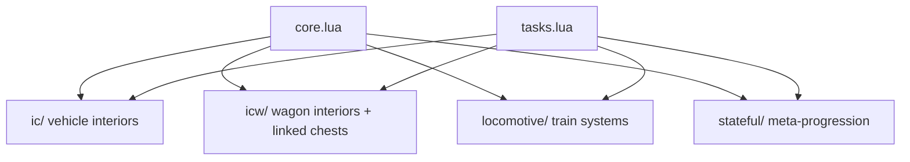
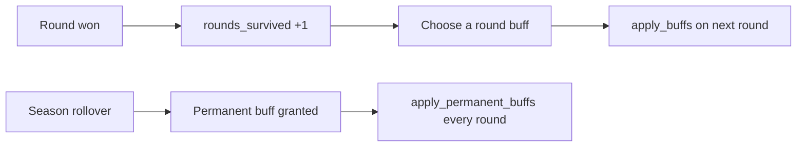

# Mountain Fortress v3 — Submodules

Deep dive into the four sub-packages under `maps/mountain_fortress_v3/`:
`ic`, `icw`, `locomotive`, and `stateful`.

## How they are wired

- `main.lua` requires `ic.main` (personal vehicle interiors) as part of entry.
- `core.lua` attaches the rest to the shared `Public` table:
  `Public.stateful`, `Public.locomotive`, `Public.defense_system`,
  `Public.friendly_pet`, `Public.market`, `Public.permission_groups`,
  `Public.spawn_locomotive`.
- `tasks.lua` drives their lifecycle on reset (`IC.reset`, `ICW.reset`,
  `LinkedChests.reset`, `stateful.enable/reset_stateful/apply_startup_settings`,
  `locomotive_spawn`).

## `ic/` — personal vehicle interiors (car / tank / spidertron)

Gives each player-owned road vehicle a **private interior surface** ("room").

- Building a `car`/`tank`/`spidertron`/`spider-vehicle` creates a hidden surface
  named `player_type_unit_number`, tiled as a room with warp doors, fish pond,
  requester/passive-provider chests, a minimap, and item transfer between the
  trunk and the chests.
- Ownership/trust is managed via GUI (`ic/gui.lua`): add player, transfer car,
  allow-anyone, auto-upgrade, drive permissions, kick, destroy surface.
- `ignore_surface_conditions` — a coin purchase per vehicle that lets machines
  inside ignore planet surface conditions.

Key files:

- `ic/table.lua` — `cars`, `doors`, `surfaces`, `trust_system`, `car_areas`,
  `ignore_surface_conditions_prices`.
- `ic/functions.lua` — `create_car`, `create_room_surface`, `save_car`,
  `restore_surface`, `kill_car`, `use_door_with_entity`, `item_transfer`, etc.
- `ic/gui.lua` — the vehicle management UI.
- `ic/minimap.lua` — in-vehicle camera/minimap.

> [!note] `ic` vs `icw`
> - **`ic`** = personal vehicle rooms — owned by one player, one room per
>   vehicle, upgradeable and transferable.
> - **`icw`** = the shared train's rolling-stock rooms — one connected interior.

## `icw/` — train/wagon interiors + linked chests

`icw` = **"interior cargo wagons"**. It converts every rail rolling-stock entity
(`locomotive`, `cargo-wagon`, `fluid-wagon`, `artillery-wagon`) into an interior
room. Wagons of a train are laid out as a contiguous strip on the train's room
surface, entered via warp doors.

- `icw/table.lua` — `wagons`, `doors`, `trains`, `carriages`, `wagon_areas`
  (default 80×100, overwritten by `stateful` based on train quality), `speed`,
  `final_battle`, `hazardous_debris`.
- `icw/functions.lua` — `create_wagon`, `create_room_surface`,
  `use_cargo_wagon_door_with_entity`, `item_transfer` (fluid-wagon ↔ tank
  equalization), train layout reconstruction (`reconstruct_all_trains`),
  `kill_wagon`, minimap.
- `icw/linked_chests.lua` — the **linked-chest / instant-teleport inventory**
  system. 16 linked chests per wagon (`wagon_<unit>_<i>`), a link/disconnect
  GUI, shift+LMB linking, coin-cost "convert to linked chest" button, and
  placement rules (active surface, inside locomotive aura, trusted players only,
  blocked during final battle).
- `icw/commands.lua` — admin `/icw_reconnect_train`.

## `locomotive/` + `locomotive.lua` — the train is the base

The locomotive (plus cargo wagon) is the team's **mobile base and win/loss
condition**. Health defaults to 10000; if it reaches 0 the game is lost.

### `locomotive.lua` (top-level)

- `check_if_spawning_near_train_custom_callback` — wave-defense callback that
  suppresses spawning near the train.
- `is_around_train` / `is_inside_zone` — aura/distance checks.
- `hurt_players_outside_of_aura` — difficulty-scaled punishment for leaving the
  aura (difficulty 1 exempt; difficulty 3 death mode; otherwise armor drain +
  damage).
- `give_passive_xp` — aura XP + permission-group assignment.
- `get_driver_action` — blocks driving without 30 min playtime / raw fish / valid
  armor.
- `sync_train_health` — clamps and distributes health ratio across carriages.
- `render_train_hp` — "Comfy Choo Choo" caption, HP text, aura circle.
- `transfer_pollution` — moves wagon-interior pollution to the main surface.

### `locomotive/market.lua`

The interior `market` entity in the locomotive wagon. Catalog:

- Team upgrades: pickaxe, train max health, aura radius, XP boost, explosive
  bullets, tile upgrade, flamethrower slots, landmines, RPG reset, zone
  purchases.
- Goods: cars/tanks/loaders/roboport/bots/storage chests/linked chest/ores/fish.

Supports quality, search, quantity slider, and a coins-left panel.

### `locomotive/defense_system.lua`

`enable_poison_defense` / `enable_robotic_defense` spawn poison clouds /
destroyer capsules around a carriage (triggered from `entities.lua`).

### `locomotive/friendly_pet.lua`

Saying "shoo" in chat spawns a friendly biter pet in the locomotive interior;
saying it again launches a rocket at it.

### `locomotive/permission_groups.lua`

Creates Factorio permission groups (`Default`, `limited`, `spectator`,
`init_island`, `near_locomotive`, `main_surface`, `not_trusted`) and restricts
deconstruct/drop/train-GUI actions. Untrusted players (<24h) go into
`not_trusted`.

### `locomotive/spawn_locomotive.lua`

`locomotive_spawn(surface, position, reversed)` clears the area, lays rails,
spawns locomotive + cargo wagon (fuel + fish), registers both with `icw`, spawns
extra stateful wagons, creates crash-site chests with starting loot, and sets
player spawn.

## `stateful/` — persistent progression across soft-resets and seasons

The **meta-progression layer** that survives soft resets and seasons.

- Tracks `rounds_survived`, `current_streak`, `best_streak`, `season`, `buffs`
  (round buffs), and `permanent_buffs` (season buffs).
- Persists snapshots to the backend (`scenario_settings` dataset) and reapplies
  buffs on every reset.

### Key structures (`stateful/table.lua`)

- Initial `this`: `enabled`, `rounds_survived`, `current_streak`, `best_streak`,
  `season`, `buffs`, `permanent_buffs`, `reset_after = 60`, `time_to_reset`.
- Runtime: `objectives`, `objectives_completed`, `selected_objectives`,
  `collection` (gather/survive timers, final-arena flags), `extra_wagons`,
  `quality_trains`, `quality_buildings`.
- `Public.quality_size` — wagon half-widths: normal 40 → legendary 60.

### Buffs

`apply_buffs` / `apply_permanent_buffs` dispatch to:

- force buffs, RPG distance/XP buffs, locomotive (extra wagons) buffs,
  quality buffs, fish buffs, tech buffs, RPG buffs, starting-items buffs.

`stateful/buffs.lua` returns the catalog of selectable buffs; `stateful/functions.lua`
handles the post-win 3-minute buff vote and objective rewards.

### Objectives & final battle

- `get_random_objectives` rolls the round's objectives (kills by damage type,
  research levels, crafting, rocket launches, spell casts).
- `set_final_battle` / `allocate` / `increase_enemy_damage_and_health` drive the
  final battle.
- `stateful/main.lua` wires objective events (`on_entity_died`,
  `on_research_finished`, `on_player_crafted_item`, `on_rocket_launch_ordered`,
  `on_spell_cast_success`) and the final-battle tick.

### What actually persists across soft-resets

| Persists | Reset each round |
| --- | --- |
| `rounds_survived`, `current_streak`, `best_streak`, `season` | `extra_wagons`, `quality_trains`, `quality_buildings` |
| `buffs` (round buffs), `permanent_buffs` (season buffs) | `objectives`, `collection` |
| season snapshot (date, `test_mode`, `disable_shutdown`, …) | objective progress |

## Related

- [[mountain_fortress/overview]]
- [[mountain_fortress/systems]]
- [[mountain_fortress/dependencies]]
