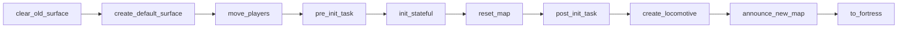

# Mountain Fortress v3 — Systems reference

Per-file deep dive of `maps/mountain_fortress_v3/`. See
[[mountain_fortress/overview|overview]] for the big picture and
[[mountain_fortress/submodules]] for `ic`/`icw`/`locomotive`/`stateful`.

## Map generation

### `terrain.lua` — biomes & zones

The map is generated in **zones** along the progression axis. The entry point is
`Public.heavy_functions(data)`, which:

1. Rejects chunks outside the lateral map width (or from the wrong surface).
2. Converts to logical coordinates via `Orient.to_logical`.
3. Dispatches per chunk: zone walls (every `zone_depth` tiles), interior zones
   (`process_bits`), the spawn border, biter-chunks, or out-of-map.

The **zone pool** (`local zones`, ~line 5464):

| Zone | Biome | Notes |
| --- | --- | --- |
| `zone_1` | Starting zone (grass/rocks/turrets) | weight 100 |
| `zone_2` | Cave ponds/chasms, worms | |
| `zone_3` | Dirt/grass ponds & rocks | |
| `zone_4` | Grass/dirt, buildings, wagons | |
| `zone_5` | Dirt, turrets, buildings | |
| `zone_7_garden` | Garden/grass, seasonal ores | |
| `zone_9` | Dirt maze | |
| `zone_11` | Dark tech/lab tiles, turrets | |
| `zone_12` | Rocky/turret | |
| `zone_13` | Forest-adjacent rocky | |
| `zone_forest_1/2`, `zone_10`, `zone_14` | Forest biomes | |
| `zone_gleba_forest_1/2` | Gleba forest | `space_age` gated |
| `zone_scrap_1/2` | Scrapyard (wrecks/chests/chasms) | |
| `zone_tech_1` | Tech ruins | **disabled** |
| `zone_frostbite_1/2` | Snow | **disabled** |
| `zone_gleba_1/2` | Gleba lowland/midland | `space_age` |
| `zone_fulgora_tech_1` | Fulgora ruins | `space_age` |
| `zone_vulcanus_1` | Vulcanus volcanic | |
| `zone_aquilo_1` | Aquilo ice | |
| `zone_crystal_1` | Crystal cave | **disabled** (non-pt2 only) |
| `zone_volcanic_1` | Volcanic | **disabled** (non-pt2 only) |

> [!note] Zone pool size
> Vanilla (non-pt2) enables ~16 zones; with `MtnFortressAddonsPt2` (`space_age`)
> it grows to ~23 zones, then `init_terrain` expands the sequence to
> `adjusted_zones.size = 132` slots via a weighted, tag-aware provider that
> avoids repeating the same tag twice in a row.

`adjusted_zones` (in `table.lua`) is the runtime terrain config: `shuffled_zones`,
`starting_tile`, `rock_raffle`, `tiles_raffle`, `direction`, `reversed`,
`disable_terrain`, and per-biome flags.

### `generate.lua` — chunk generation driver

UPS-friendly generation via the task queue:

- `schedule_chunk(event)` queues a chunk's 1024 tiles in slices of
  `tiles_per_call = 12`.
- `map_gen_action(data)` is a state machine (rows 0–31 generate tiles; later
  states chart, place hidden tiles/rocks/entities/buildings/markets/treasure/
  decoratives, then relay "chunk ready").
- `force_do_chunk(event)` generates a chunk synchronously in one pass (used for
  starting chunks).
- `Public.prepare_starting_chunks` / `Public.advance_starting_chunks` make sure
  the map is ready before the locomotive spawns.

### `get_perlin.lua` — noise

`Public.get_noise(name, pos, seed)` sums weighted octaves from a library of
~25 named multi-octave templates (`cave_ponds`, `scrapyard`, `forest_density`,
`ore`, …) and returns roughly `[-1, 1]`. `terrain.lua` wraps lookups in
`seasonal_noise(...)`, scaling most templates by the current season (caves grow,
water/rocks shrink over seasons).

### `surface.lua` — surfaces

- `Public.create_surface(recreate)` builds map-gen settings (water `0.001`,
  starting_area `1`, no cliffs, no autoplace) and creates the planet surface
  (`game.planets[starting_planet].create_surface()` modded, `fortress` vanilla).
- `Public.create_landing_surface()` creates the `'init'` waiting room
  (256×256 `nuclear-ground` with steel wall).
- Horizontal maps use `width = 0` (endless ribbon).

> [!warning] Known quirks
> - `Public.get_active_surface()` returns `this.active_surface`, but the actual
>   field stored is `this.active_surface_index` — likely a latent bug.
> - `surface_id.lua` returns `'fortress'` but is **not required anywhere** (dead
>   file).

## The scenario task state machine (`tasks.lua`)

`tasks.lua` registers an `on_tick` "scenario manager" that reads
`current_task.state` and dispatches `Public[state](current_task)`. States, in
order:

Each state waits for its prerequisites (season settings ready, surface deletion
done, chunks generated) before advancing.

## Shared helpers (`functions.lua`)

The biggest shared file (~3.9k lines). Highlights:

| Function | Purpose |
| --- | --- |
| `Public.set_difficulty()` | Recompute wave-defense difficulty from the vote + player count. |
| `Public.boost_difficulty()` | One-time early-game buff. |
| `Public.set_spawn_position()` | Recompute WD spawn relative to collapse/locomotive. |
| `Public.set_wd_surface_index()` | Push active surface index into Wave Defense. |
| `Public.set_threat_values()` / `set_unit_raffle()` / `set_worm_raffle()` | Configure wave-defense threat/raffles. |
| `Public.set_xp_yield()` | Configure RPG XP yields. |
| `Public.find_void_tiles_and_replace()` | Snapshot void/water tiles for slow replacement. |
| `Public.find_rocks_and_slowly_remove()` | Snapshot rocks for slow removal. |
| `Public.is_creativity_mode_on()` / `disable_creative()` | Creative-mode handling. |
| `Public.game_is_over()` | (in `entities.lua`) sets `game_lost`, calls `loco_died()`. |
| `Public.equip_players()` | Clear inventory, grant starting items/armor. |

It also exposes callback **tokens** used by other systems:

- `pause_waves_custom_callback_token` — ties wave pause to collapse when wave ≥ 200.
- `fishy_callback_token` — fish bait adds threat (100/200) with cooldown.
- `magicka_custom_callback_token`, `x_marks_the_spot_custom_callback_token`.
- `surface_validation_token` — validates players are on the interior surface.
- Entity/turret/power callbacks (`deactivate_callback`, `refill_turret_callback`,
  `magic_item_crafting_callback`, …).

## `entities.lua` — mining, loot, game over

- Registers the "coins collected" statistic.
- `mining_events` — a large weighted table of random mining outcomes (Nothing,
  Angry Biter/Worm, Dangerous Trap, Angry Tree, Treasure tiers 1–7, Nest, VSMG,
  …).
- `protect_entities` — anti-grief protection; reflects damage to protected
  entities (wagons, locomotive, reactor, vehicles).
- `set_train_final_health` — applies damage to the shared train health pool;
  triggers poison/robotics defenses at thresholds, `game_is_over` at 0.
- `hidden_treasure` — spawn loot chests from mining (rarity based on RPG magicka).
- `angry_tree` — trees fight back (buried biters/worms, projectiles, or an enemy
  turret).
- `Public.loco_died()` — the defeat sequence: stop collapse, reset win streak,
  alert, set all forces friendly, spawn a fake shooter + atomic rocket.
- Also `require`s `modules.rocks_broken_paint_tiles` as a side effect.

## Economy

### `mining.lua`

Replaces vanilla mining output for rocks, trees, wrecks, and Fulgora ruins with
weighted random drops (components, ores, modded ores when pt2), scaled by entity
type, planet multiplier (fulgora/aquilo ×1.2, nauvis ×1.5), distance from center,
and mining productivity. Drops go to inventory or spill on the ground
(`spill_items_to_surface`; > 60 items inserted directly).

### `loot.lua` + `loot_raffle.lua`

- `loot.lua` spawns neutral loot chests. Budget = `loot_stats.normal + |progression|*1.75`
  (rare variant uses `magic * loot_stats.rare`), with coin jackpot chains.
- `loot_raffle.lua` converts a budget into item stacks using the `item_worths`
  price table (iron-plate 1 … rocket-silo 65536), with zone bias and quality.

### `biters_yield_coins.lua`

Awards coins per biter kill (base + boss scaling + quality). Killer gets coins
(or they spill on the ground); turret kills spill at the turret. See
`coin_yield` for per-entity values (small biter 1 … demolishers 100–400, giant
worm 200).

### `resource_generator.lua` — "magic crafting" buildings

Neutral assemblers/furnaces/refineries placed in the wild that produce
items/fluids with no inputs. Output scales with distance from center; deeper
zones spawn higher-tier buildings. Loot lists: science, ammo, oil, resources,
furnace plates.

### `mystical_chest.lua`

A central requester chest the team feeds a rolled shopping list
(`mystical_chest_price`). Completing it opens a 3-choice reward GUI (XP, science,
ammo, market reroll, coin overclock, lab overclock, oil, coins, speed boosts).
Boons have cooldowns (30 min most, 15 min overclocks).

### `basic_markets.lua`

Generates neutral `market` entities with randomized coin-priced offers (items
drawn from `market_settings`, priced ±25%; resource buy/sell offers). Prices cap
at 64000.

### `rocks_yield_ore_veins.lua`

On mining (1/512 chance, halved near the train), spawns a new ore patch ("ore
vein") near the entity. Patches chain and scale richness with distance.

## Progression

### `breached_wall.lua`

Enforces map progression: players can only advance up to `zone_depth × bonus`
from the locomotive. Crossing the breach boundary increments `breached_wall`,
raises XP, resets biters, starts collapse, and unlocks rewards (spidertron at
zone 11, artillery warning at wall 5, tungsten/calcite in ore raffles at specific
walls).

### `balance.lua`

Tunes enemy weapon damage per difficulty vote (`enemy_weapon_damage()` adds
`Difficulty.get().value * v` to enemy force modifiers).

### `flag_mission.lua` + `flag_rewards.lua`

Capture-the-flag side missions (after wave 200): walk to a flag post, carry the
flag back to the locomotive within a deadline. Carrying spawns escalating buried
enemies; death fails. Delivery awards coins + item + XP (tiered by wave).

### `relay_station.lua`

Spawns "abandoned relay station" entities (small/medium/large) ahead of the
locomotive once chunks are ready. Tracks readiness, retires destroyed stations,
re-places failures.

### `traps.lua`

Tick-scheduled "tick-tack" traps: a countdown speech bubble then a random
"kaboom" (grenades, capsules, projectiles, or a coin chest), optionally a
death-blast AoE.

### `buried_enemies.lua`

Schedules "dug up" enemies/worms/tech capsules after a 60-tick particle
telegraph. Respects the global biter cap (`biters.limit = 512`).

## Scores & persistence

### `highscore.lua`

Persistent "Highscore" tab: top-10 kills/built/mined + global run stats
(rockets, enemies killed, breached zones, highest wave). Dataset `highscores` →
`mountain_fortress_v3_scores`.

### `season_highscore.lua`

"Seasons" tab: historical season results (season, rounds survived, best streak,
buffs granted, dates). Dataset `seasons` → `mtn_v3` / `mtn_v3_dev`.

### `mvp_history.lua`

Persists per-round MVP records into `scenario_settings` → `mtn_v3_mvps`.

### `soft_reset.lua`

Clears the old surface (and robots within radius 512), resets forces/techs/
evolution, teleports players, and orchestrates staged surface clearing via a
scheduler. Used instead of a full restart when soft-reset is enabled.

## GUI (`gui.lua`)

The main top-bar HUD + spectate UI:

- Expandable info frame: global XP pool, mined scrap, pickaxe tier, biters
  killed, landmine/flamethrower limits, train upgrade contribution, defense
  status, mystical-chest counter.
- Spectate frame: spectator/play toggle, surface picker.
- Mystical-chest button consumes required items from the player inventory.

## Commands

Registered in `commands.lua` (all admin unless noted). See
[[hosting#admin-commands]] for the lifecycle commands; the full list:

| Command | Purpose |
| --- | --- |
| `/scenario restart\|shutdown\|reset\|restartnow` | Lifecycle control. |
| `/mtn_set_queue_speed <n>` | Set task queue speed. |
| `/mtn_complete_quests <no_grace> <instant_win>` | Force-complete objectives. |
| `/mtn_reverse_map` | Toggle map reversal. |
| `/mtn_set_direction north\|south\|east\|west` | Set map direction. |
| `/mtn_disable_biters` | Toggle wave-defense loss. |
| `/mtn_toggle_darkness` | Toggle surface darkness. |
| `/mtn_grant_permanent_buff` | Grant a permanent team buff. |
| `/mtn_toggle_orbital_strikes` | Toggle orbital strikes. |
| `/mtn_get_queue_speed` | Print queue speed. |
| `/mtn_disable_collapse` | Toggle collapse. |
| `/mtn_spawn_flag` | Spawn a flag mission manually. |
| `/mtn_mystical_reward` | Debug mystical reward. |
| `/mtn_grant_fake_buff` | (offline/debug) Open buff-selection GUI. |

## Related

- [[mountain_fortress/overview]]
- [[mountain_fortress/submodules]]
- [[mountain_fortress/dependencies]]
